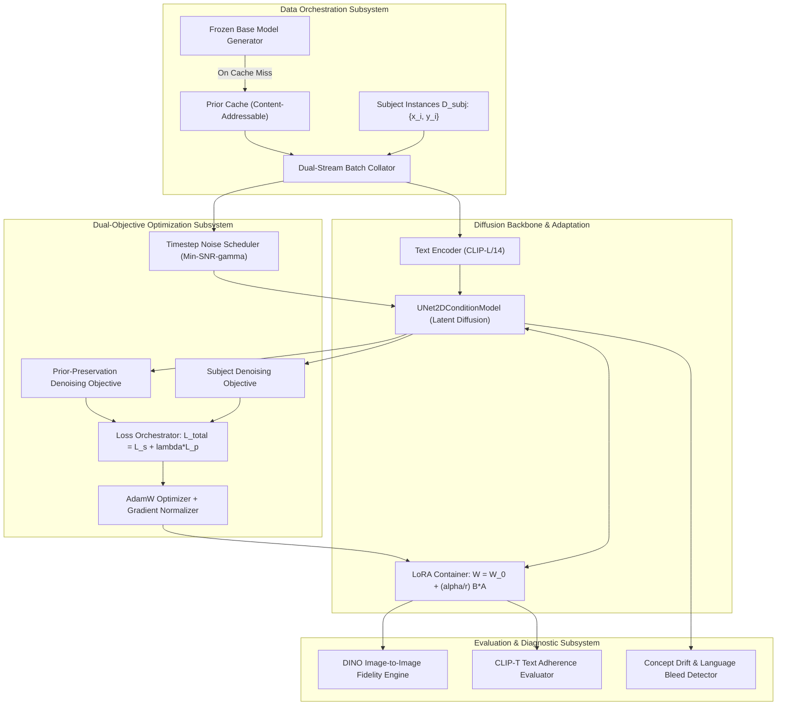

# System Architecture Blueprint

This document details the architectural specifications, subsystem dataflows, and failure-mode mitigation protocols implemented across PriorAnchor.

## Architectural Overview

PriorAnchor coordinates subject-driven personalization of latent diffusion architectures through dual-stream gradient updates. The system isolates parameters into frozen base backbones and trainable low-rank adaptation matrices, eliminating catastrophic forgetting while maintaining fine subject fidelity.

## Subsystems

### 1. Dual-Stream Data Pipeline

The data pipeline pairs subject instance data with prior class samples:

- **Subject Stream**: Pulls from 3-10 reference images of the target subject with prompt `"a photo of a [V] {class_noun}"`.
- **Prior Stream**: Pulls from 200+ class-generic images with prompt `"a photo of a {class_noun}"`.
- **Batch Pairing**: Interleaves one subject sample with one prior sample at each forward pass, synchronizing noise timesteps or sampling independent timesteps $t \sim \mathcal{U}(0, T)$ and $t' \sim \mathcal{U}(0, T)$.

### 2. Parameter-Efficient Low-Rank Adaptation (PEFT)

To preserve the base manifold, weights outside the cross-attention projection matrices remain strictly frozen:

$$W_{adapted} = W_{base} + \Delta W = W_{base} + \frac{\alpha}{r} B \cdot A$$

Where:
- $W_{base} \in \mathbb{R}^{d_{out} \times d_{in}}$ is frozen.
- $A \in \mathbb{R}^{r \times d_{in}}$ initialized from Gaussian distribution $\mathcal{N}(0, 1/d_{in})$.
- $B \in \mathbb{R}^{d_{out} \times r}$ initialized to zero, ensuring $\Delta W = 0$ at step 0.
- Target projections: Cross-attention queries ($W_q$), keys ($W_k$), values ($W_v$), and output projections ($W_o$).

### 3. Loss Orchestration Subsystem

The dual-objective loss formulation prevents language drift by applying simultaneous supervised penalties on both subject and class representations:

$$\mathcal{L}_{total} = \mathcal{L}_{subject} + \lambda(t) \mathcal{L}_{prior}$$

When $\lambda > 0$, any parameter update that causes the model to output the customized subject when prompted with generic class text produces a steep penalty under $\mathcal{L}_{prior}$, preserving category diversity.

### 4. Ecosystem Adapters and Inference Pipeline

- **SafeTensors Binary Serialization**: Zero-copy binary serialization format using an 8-byte uint64 header prefix, UTF-8 JSON tensor map, and contiguous little-endian float32 buffers, fully interoperable with Diffusers and ComfyUI.
- **PriorAnchorPipeline**: Inference runtime coordinating Classifier-Free Guidance (CFG):
  $$\epsilon_{guided} = \epsilon_{uncond} + s \cdot (\epsilon_{cond} - \epsilon_{uncond})$$
  Supports exact weight folding (`fuse_lora`) for zero-overhead inference execution:
  $$W_{fused} = W_{base} + \frac{\alpha}{r} B \cdot A$$

## Failure Modes and Mitigations

| Failure Mode | Root Cause | Architectural Mitigation |
|---|---|---|
| **Catastrophic Forgetting** | Over-optimizing diffusion weights on subject images without category regularization. | Enforced prior-preservation loss ($\lambda \ge 0.5$) with base model synthetic prior caching. |
| **Language Drift** | Rare token $[V]$ semantic bleed into class noun embeddings in text encoder. | Text encoder frozen or trained with dedicated lower learning rate ($5 \times 10^{-6}$ vs $1 \times 10^{-4}$). |
| **Noise Gradient Collapse** | High-variance gradients at extreme noise timesteps dominating optimization. | Min-SNR-$\gamma$ loss weighting truncating gradient norms at low signal-to-noise ratios. |
| **Overfitting / Background Memorization** | Subject images memorized with fixed backgrounds and illumination. | Diverse class prior prompt templates and optional random flip/crop augmentations. |
